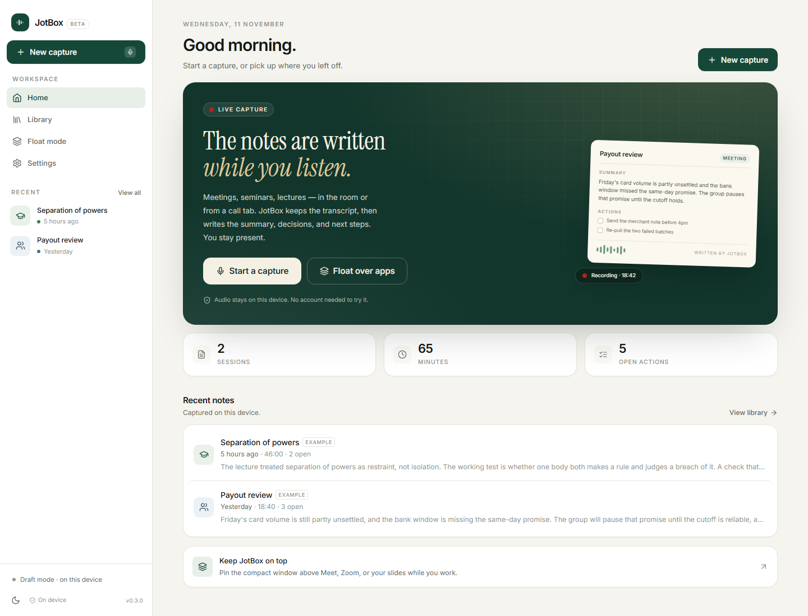
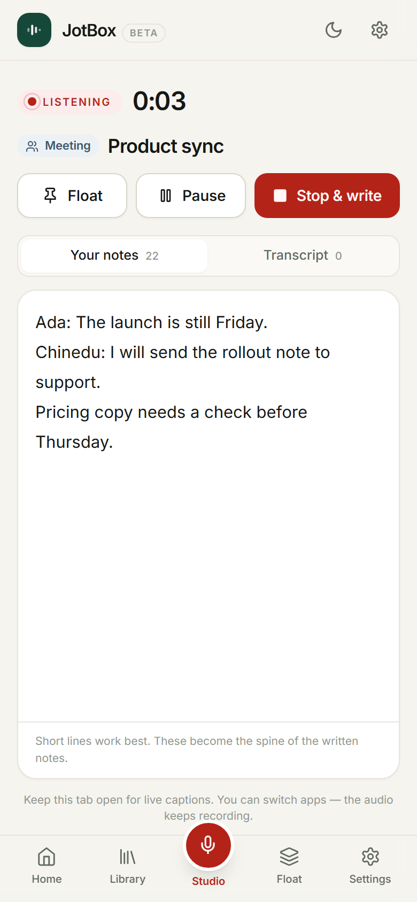
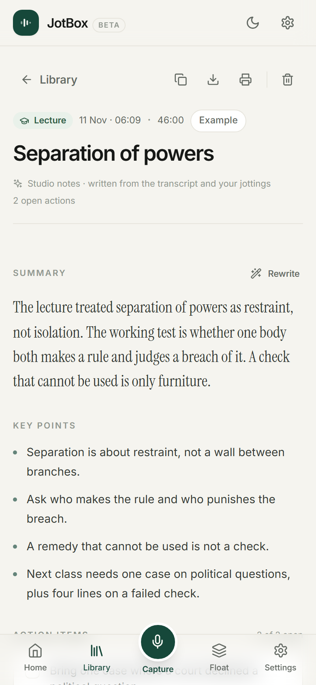
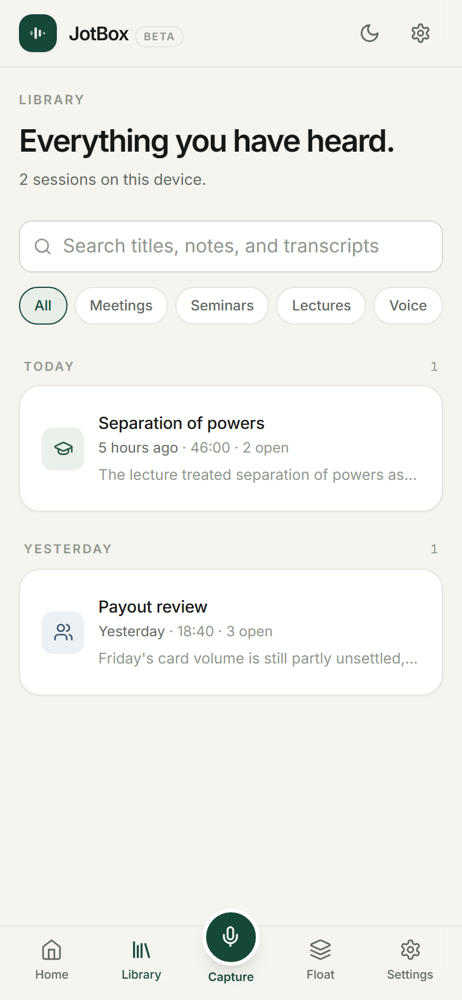
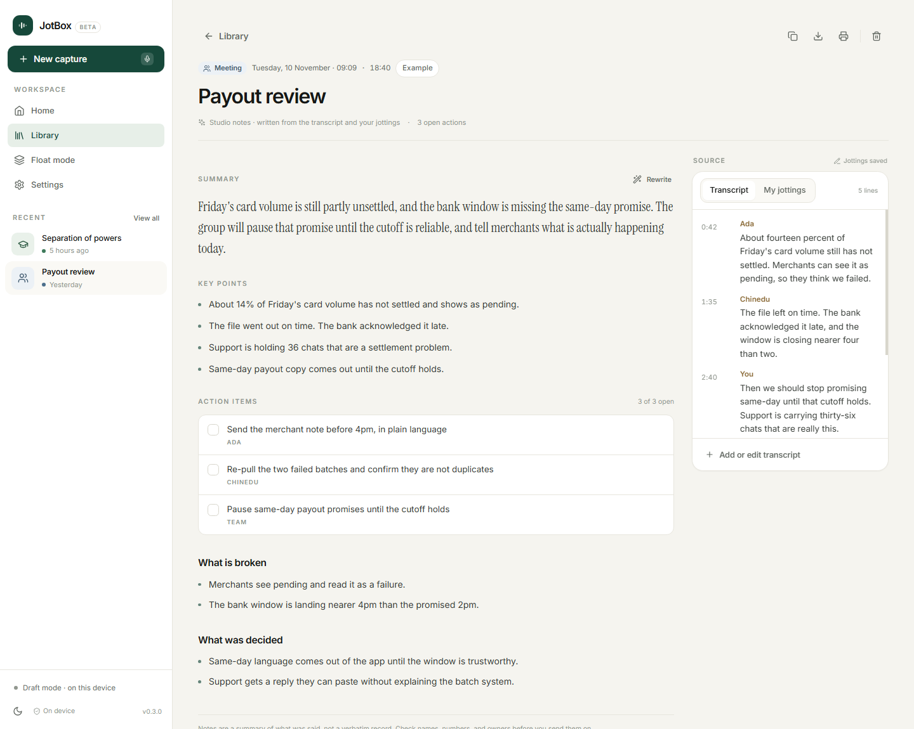
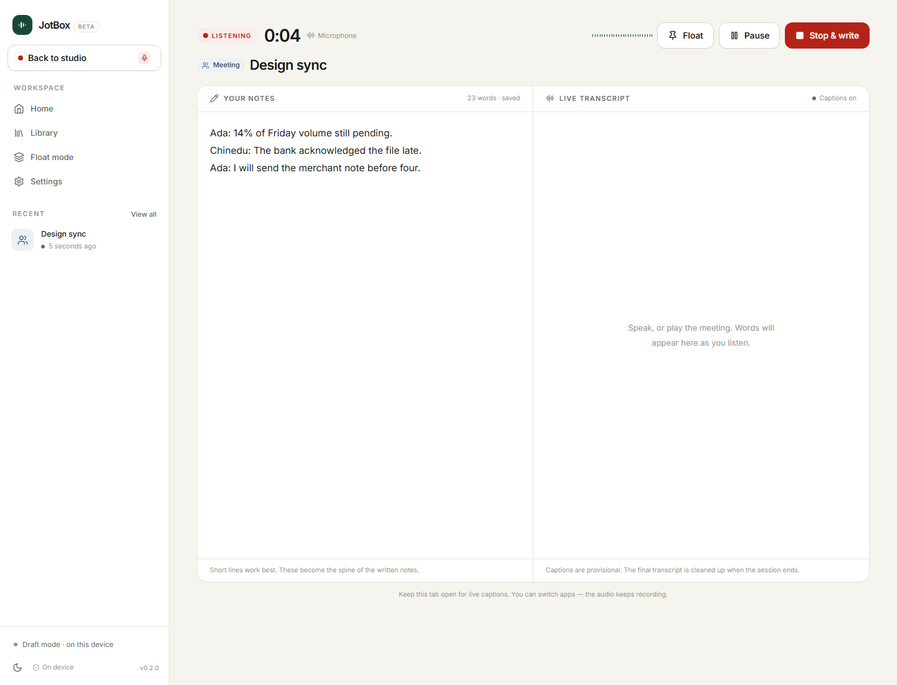
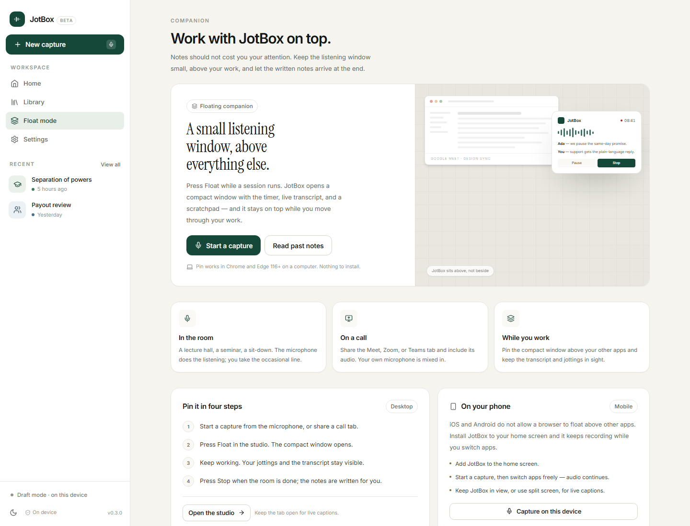

# JotBox

**The notes are written while you listen.**

JotBox is a mobile-first, local-first notetaker for meetings, seminars, lectures, and voice notes. It listens through the microphone or a shared call tab, keeps a live transcript, lets you jot a line or two, and writes the summary, key points, actions, and sections when you stop. On a computer it can float above your other apps.



## The product

Most note-taking tools ask you to type while someone is talking, or they join a call as a bot. JotBox is built for the way sessions actually happen here: a phone on the table in a lecture hall, a laptop on a Meet or Zoom call, a voice memo in traffic. There is no account, no meeting bot, and no cloud library to maintain. The audio stays on the device unless studio transcription is explicitly enabled.

Four session shapes set the tone of the notes: **Meeting**, **Seminar**, **Lecture**, and **Voice note**.

## What is built

- **Capture** from the microphone, from a shared call/tab with your mic mixed in, or by uploading an audio file.
- **Live studio** with two panes: your jottings and the live transcript. On a phone the panes become tabs.
- **Written notes** with a summary, key points, action items (checkboxes and owners), and topic sections.
- **Repair paths** when a recording fails: paste or edit a transcript, or rewrite the notes from what was captured.
- **Floating companion** using Document Picture-in-Picture, so the timer, transcript, and scratchpad stay on top of other apps on desktop Chrome/Edge.
- **Library** with full-text search, session-type filters, and date groups.
- **Exports**: copy as Markdown, download `.md`, print, or save as PDF.
- **Local-first storage**: sessions in `localStorage`, audio blobs in IndexedDB. No backend account.
- **PWA**: installable on a phone, standalone window, offline shell.
- **Graceful draft mode** if no AI key is configured: browser captions and on-device draft notes still work.

<div align="center">
  
  
  
</div>

## Run it

```bash
npm install
npm run dev:web
```

Open **http://localhost:3100**. Add `?demo=1` to any URL to load two example sessions (for example `http://localhost:3100/?demo=1`).

The `?demo=1` examples are stored like normal sessions; remove them from Settings whenever you like.

### Studio transcription (optional)

Without a key, JotBox runs in **Draft mode**: the microphone still gets live browser captions, and notes are drafted on the device from the transcript and your jottings. Recording and uploads are saved locally, but they are not transcribed.

To turn on studio transcription, create a `.env` at the repository root:

```env
XAI_API_KEY=your_key_here
```

The key is read by the Vite server only; it is never sent to the browser. Restart the dev server after adding it.

Optional model overrides:

```env
XAI_STT_MODEL=grok-voice-transcribe-2.0
XAI_NOTES_MODEL=grok-4.7
```

The studio endpoints are:

- `GET /api/health` → whether a key is configured
- `POST /api/transcribe` → audio in, transcript out
- `POST /api/enhance` → transcript + jottings in, structured notes out

### Production build

```bash
npm run build:web
npm run preview:web
```

Preview runs on **http://localhost:3101** and includes the API middleware. The built app is in `apps/web/dist`.

### Deploy

The repo includes [`vercel.json`](vercel.json) for the SPA build and route fallback:

```bash
vercel --prod
```

The Vercel build runs `npm run build:web` from the repository root and serves `apps/web/dist`. The three studio endpoints currently live in the Vite dev/preview middleware; a pure static Vercel deployment runs in **Draft mode** until those endpoints are moved to serverless functions. Add `XAI_API_KEY` to the Vercel project environment when the functions are in place.

## Screens

| Screen | What it does |
| --- | --- |
| Home | Greeting, live-capture hero, capture stats, recent notes |
| Capture | Pick a session shape, name it, choose microphone / call tab / upload |
| Studio | Timer, notes pad, live transcript, pause/resume, float, stop and write |
| Notes | The written document, audio + transcript source panel, exports, rewrite |
| Library | Search, type filters, date groups |
| Float mode | How the companion window works on desktop and what is possible on a phone |
| Settings | Appearance, studio status, local data usage, export/clear, privacy |





## How it works

```text
microphone / tab audio / upload
        │
        ├─ MediaRecorder ──> IndexedDB (audio)
        │
        ├─ Web Speech API ──> live transcript lines
        │
        └─ on stop ──> /api/transcribe (studio mode)
                        │
                        └─ /api/enhance
                              summary + key points + actions + sections
                              │
                              └─ Zustand persisted session ──> notes document
```

If the studio is unavailable, `buildNotes` falls back to `localNotes`: a transparent, on-device heuristics pass over the transcript and jottings. Draft notes are labelled **Draft notes · written on this device** so nobody mistakes them for a studio transcript.

### Data model

- `Session`: title, kind, status, duration, scratch notes, transcript, notes, audio flag
- `TranscriptLine`: speaker (optional), text, timestamp
- `SessionNotes`: summary, highlights, action items, sections, source (`studio` or `browser`)
- `ActionItem`: text, owner, done

## Stack

- React 18, Vite 5, TypeScript strict
- Tailwind CSS with a small custom design-token layer
- Zustand + `persist` for session state; IndexedDB for audio
- React Router
- xAI chat + speech-to-text endpoints
- `vite-plugin-pwa` (Workbox)
- No cloud dependency in the current build

### Project layout

```text
apps/web/
  server/apiPlugin.ts     dev/preview API middleware
  src/components/         shell, waveform, transcript, kind badges, dialogs
  src/engine/             capture engine (mic/tab, MediaRecorder, Web Speech, PiP)
  src/lib/                notes building, formatting, exports, store, seed data
  src/pages/              Home, Listen, Session, Library, Float, Settings
docs/screenshots/
```

## Limits worth knowing

- **Floating above other apps is desktop-only.** It uses Document Picture-in-Picture in Chrome/Edge 116+. iOS and Android do not let a browser window float over native apps. The phone experience is an installable PWA that keeps recording when you switch apps; live captions need JotBox in view.
- **Live captions are browser speech, not the studio model.** They are provisional and can stop when the tab is backgrounded. The recording itself continues; studio transcription cleans it up afterwards.
- **Studio endpoints live in the Vite dev/preview server.** A static deployment needs those three routes ported to serverless functions before studio transcription will work in production. Draft mode and local capture work without them.
- **Browser storage is not a backup.** Clearing site data removes sessions and audio. Export from Settings or download a Markdown copy of notes you care about.
- **No accounts, sharing, or sync yet.** Everything is on one device by design for this phase.

## Roadmap

1. **Backend hardening** — port the studio endpoints to a serverless host, add request limits, retries, and usage accounting.
2. **Sharing** — a clean read-only note link, WhatsApp/email share, PDF and DOCX exports.
3. **Capture depth** — system-audio guidance for Windows and macOS, meeting-calendar detection, speaker naming that persists across sessions.
4. **Local languages** — Yoruba, Igbo, Hausa, and Nigerian Pidgin transcription options, plus an offline Whisper path for low-connectivity rooms.
5. **Teams and monetisation** — shared spaces, templates per faculty/team, free minutes then a Pro plan.

See [implementation-plan.md](implementation-plan.md) for the working plan and decision log.
